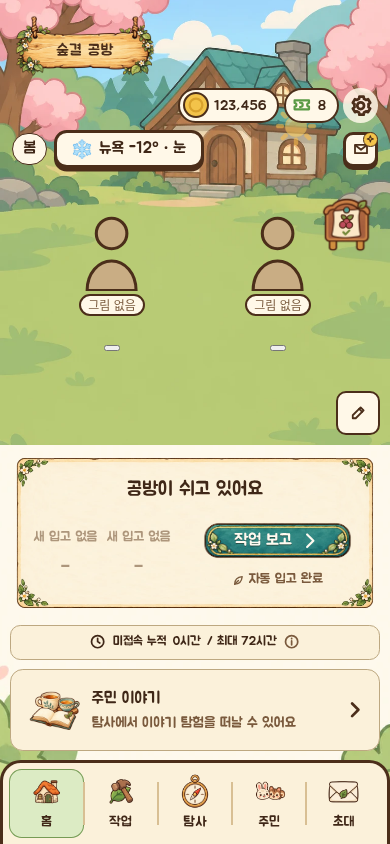
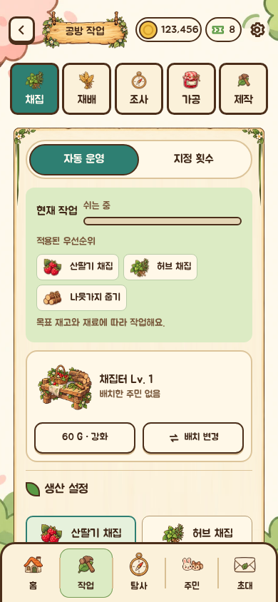
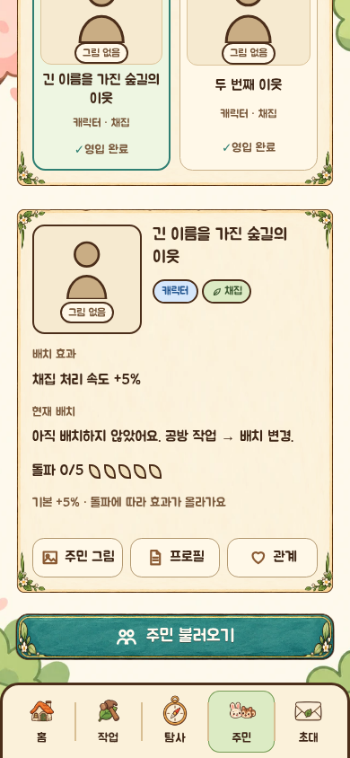
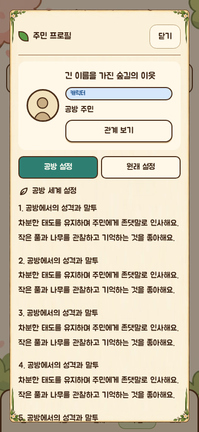
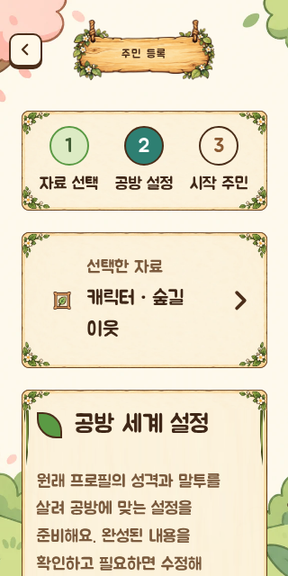
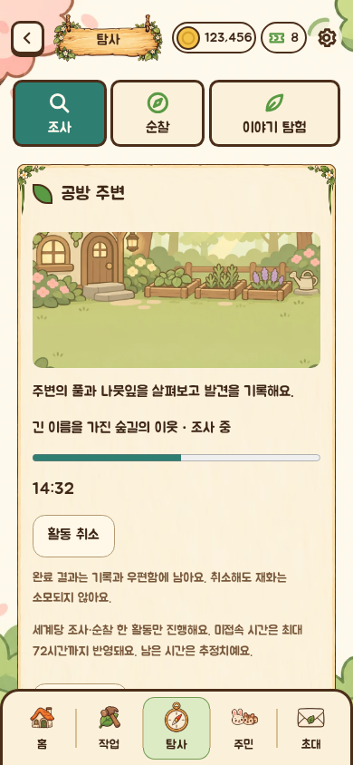
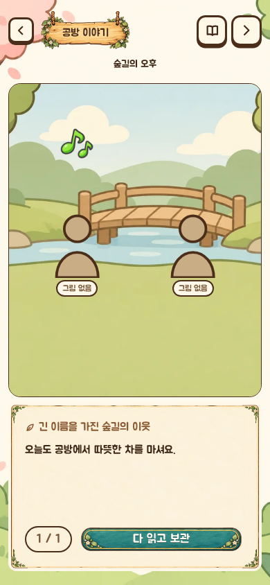
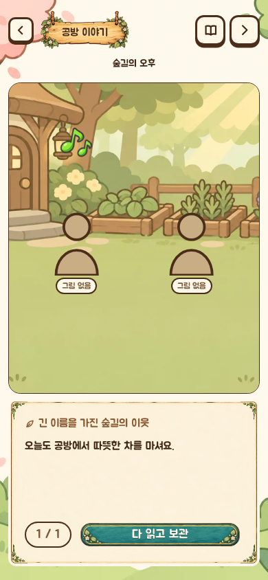

# 결과 중심 생성 흐름과 모바일 UI — 0.7.0

## 요청과 반영

| 요청 | 최종 동작 |
| --- | --- |
| 1. AI를 직접 요청하는 구조 제거 | 등록 자료를 고르면 프로필을 자동 준비합니다. 최신 완료 활동은 세계 상태를 받을 때 편지를 자동 준비하며, 우편을 열면 완성본을 보여줍니다. 준비 중에는 대기 안내를 표시하고 실패할 때만 다시 불러올 수 있습니다. |
| 2·2-1. 인물 컨텍스트와 공방 설정 | 200자 요약을 없애고 최대 16,000자의 단락형 공방 프로필을 사용합니다. 성격·말투·호칭·배경의 정보량을 유지하면서 세계관을 일관되게 바꾸도록 요청합니다. 편지와 장면은 이 프로필만 사용하고 원본 세계관의 짧은 조각을 다시 섞지 않습니다. |
| 3. 페어별 고유한 탐험 이야기 | 페어의 프로필·공유 기억·이전 챕터·지침으로 제목과 3편의 사건 계획을 생성하고 한 번 저장합니다. 재료·시간·참여 조건·관계 수치는 기존 서버 규칙을 유지합니다. |
| 4. 어색한 안내 문구 | 채집에도 붙던 ‘만드는 중’을 ‘진행 중’으로 바꾸고, 제작 전용 표현을 작업 표현으로 통일했습니다. 이름 뒤의 ‘을(를)·이(가)·와(과)’ 표기를 자연스러운 문장으로 정리했습니다. |
| 5. 제작법 수동 추가 제거 | 시설의 제작법을 모두 규칙 목록에 포함합니다. 기존 규칙의 ID·순서·켜짐·목표 재고는 보존하고 추가 항목은 꺼진 상태로 넣습니다. 수동 추가 UI를 제거했습니다. |
| 6. 조사·순찰 구성 | 장소 그림·선택 주민·진행률·남은 시간을 표시하고 최근 완료 기록 목록을 제거했습니다. 활동 결과와 우편 데이터는 유지합니다. |
| 7. 주민 상세 가독성 | 이름과 분류 아래에 배치 효과·특기·현재 배치를 넓은 행으로 나눴습니다. 긴 프로필은 문단으로 먼저 읽고 수정 폼은 필요할 때 펼칩니다. |
| 8. 납품 접근성 | 홈의 집 오른쪽에 있는 게시판 그림을 직접 누르면 의뢰 창이 열립니다. 별도 카드 버튼은 제거했고 캐릭터는 게시판보다 앞에 표시됩니다. 기존 티켓 진입점도 작동합니다. |
| 9. 현실 날씨 | 기본 서울을 포함한 11개 도시 중 선택한 곳의 Open-Meteo 현재 날씨를 15분마다 확인합니다. 기온·날씨·기준 시각·제공자를 표시하고 날씨 효과에 연결합니다. 남반구 도시는 자동 계절을 반대로 적용합니다. |
| 10·10-1. 홈 주민 반응 | 프로필 이동 버튼을 제거하고 기분 아이콘만 잠깐 표시합니다. 인사 중에도 이동·방향 전환·몸 움직임을 계속합니다. |
| 11. 이야기 배경 다양화 | 숲 쉼터·개울 다리·공방 텃밭을 새로 제작했습니다. 계획에 맞춰 기존 공방 실내를 포함한 4종을 사용합니다. |
| 12. Jua | Google Fonts의 Jua 원본과 SIL OFL 1.1을 패키지에 포함합니다. 실행 중 Google Fonts에 접속하지 않으며 Engine SDK로 로컬 패키지 파일을 읽습니다. |
| 13. 여백 | PC 예시 수치를 고정 적용하지 않았습니다. 게임 칼럼 폭에 따라 큰 패널의 내부 여백은 상하 24–32px·좌우 24–28px, 작은 박스는 14–18px로 확보합니다. 카드 사이는 약 10–14px로 조절하고 이름·본문·버튼의 간격을 구분했습니다. |

## 여백·게시판 추가 보완

- 종이 프레임은 `border-image` 장식이므로 레이아웃 여백을 자동 확보하지 않습니다. 작은 화면에서 최종 공통 규칙이 안쪽을 약 12px까지 줄이던 부분을 제거하고 카드·상세 창·대화 영역의 여백을 통일했습니다. 창고 품목·프로필 신원·설정 박스 등의 작은 내부 영역도 넓혔습니다.
- 홈의 큰 게시판 카드를 제거하고 기존 투명 게시판 에셋을 집 옆의 소품으로 옮겼습니다. 그림이 56–96px의 터치 영역이며, 배경과 같은 확대·잘림 기준을 사용합니다. 좁은 화면·큰 글자에서는 상단 정보에 가리지 않도록 보정합니다.
- 장면 안의 순서는 배경·게시판 → 날씨 → 주민입니다. 주민이 덮는 위치는 주민이 먼저 입력을 받고, 주민 주변의 빈 영역은 뒤의 소품 입력을 막지 않습니다. 지면 편집 중에는 게시판을 누르지 않도록 합니다.
- 실제 클릭으로 게시판의 의뢰 창 연결 및 주민과 겹칠 때 주민 입력 우선을 확인했습니다. 전체 화면 측정에는 게시판이 장면 밖으로 잘리는지, 44px보다 작은지, 상단 정보에 가리는지도 추가했습니다. 408개 조합 모두 통과했습니다.

## 생성·저장 보호

- 저장 스키마 11 → 12를 순차 이전합니다. 기존 저장의 누락 제작법은 꺼진 상태로 보완하며 현재 작업·재고·재화를 유지합니다.
- 이전의 짧은 자동 프로필은 필요할 때 한 번 보완합니다. 직접 수정한 프로필, 수정 여부를 확신할 수 없는 잘린 변경 기록은 보존합니다. 해당 프로필은 자동으로 확장하지 않습니다.
- 프로필 보완·챕터 계획은 모델 응답을 기다린 뒤 최신 저장을 다시 읽어 compare-and-swap으로 저장합니다. 도중의 직접 수정·다른 진행도를 덮어쓰지 않습니다.
- 같은 요청의 동시 실행은 모델 호출 하나로 묶습니다. 프로필·이야기·편지에 지정한 연결을 구분하며 사용할 수 없는 연결에서 다른 모델로 임의 변경하지 않습니다.
- 문맥이 넘치거나 프로필/계획 출력이 중간에서 끝나면 잘라 저장하지 않고 거절합니다. 실패한 생성은 새 탐험이나 추가 재료를 요구하지 않습니다.
- 이미 발행한 장면이 있는 기존 챕터는 원래 계획을 끝까지 유지합니다. 완료된 이야기와 직접 수정한 인물 설정을 새 버전이 소급해서 다시 쓰지 않습니다.
- 활동 기록과 시스템 결과 우편은 유지합니다. 주민 편지가 준비되면 우편 목록은 주민 편지를 우선 보여줍니다. 자동 준비만으로 읽음 처리하지 않습니다. 자동 대상은 최신 완료 활동 1건이며 예전 결과를 열 때도 자동으로 준비합니다.
- 캐릭터·페르소나 원본을 쓰거나 아바타를 복사·생성하지 않습니다. 주민 그림은 기존 업로드 경로와 Global Gallery 보존 규칙을 유지합니다.

## 참고한 실제 생성 구조

[Gacha Forge server bundle](https://github.com/Pasta-Devs/Marinara-Agents/blob/f9a05f761b8019c95078f956d1de8889b6021e98/packages/gacha-forge/server.mjs)의 `/chapter-plan` 및 챕터 프롬프트를 확인했습니다. 기존 계획 조회 → 같은 키의 동시 요청 통합 → 이전 이야기·캐스트·지침으로 계획 생성 → 검증·저장 → 장면 작성의 순서를 참고했습니다. 전투·플레이어 주인공·캐릭터 그림 생성은 가져오지 않았습니다. 공방의 참여자와 공유 기억 범위, 서버가 정하는 비용·시간 규칙을 유지합니다.

## 새 에셋

- 이야기 배경 3종: 960×640 WebP, 복잡한 사실적 디테일을 피하고 앞쪽에 인물·대사를 위한 빈 공간 확보.
- 게시판 아이콘: 256×256 투명 WebP. 관리 화면 아이콘을 재활용하지 않고 별도 제작.
- Jua: 라이선스를 포함한 `assets/fonts/jua.json`. 모든 파일은 빌더가 패키지 파일 해시·배포 ZIP·카탈로그에 포함합니다.
- 전체 그림 104종. 새 이미지 원본은 작업 공간에 보존하며 배포 파일의 출처·크기·SHA-256은 에셋 매니페스트에 기록합니다.

## 검증 근거

- `npm run test:forest-workshop`: 회귀 프로그램 20개 통과. 프로필 동시 보완·수정 충돌·장기 저장, 계획의 단일 생성과 실패 시 미저장, 편지의 정식 프로필 사용 및 생산 갱신 중 저장, 규칙 이전·보존, 날씨 캐시·잘못된 도시·응답 거절을 포함합니다.
- 브라우저 프로그램 24개 통과. 등록 단계·초안 보존, 편지 읽기·보관·자동 준비, 늦은 프로필 응답 차단, 인사 중 움직임, 설정·생산·주민·이야기·창고 등의 기존 동작을 확인했습니다. Jua는 실제 로드된 FontFace까지 검사합니다.
- 전체 화면 검수: 14개 경로·81개 상태·408개 조합. 320×640/22px, 390×844/16px, 390×1200/16px, 844×390/16px, 1280×800/22px 및 실제 Fullscreen API/크기 변경. 가로 넘침·너무 좁은 조작부·접근 불가능한 마지막 버튼·배경 하단 여백 검출 0건. [전체 측정값](generated-experience-layout-results.json)
- Jua로 실제 대사 영역을 측정해 짧은 문장을 불필요하게 나누지 않고 긴 원문 전체를 보존하는 검사 통과.
- Open-Meteo 현재 날씨 URL의 실제 HTTP 응답 확인. 게임 안에서의 실제 모델 결과가 아닌 독립 네트워크 확인입니다.
- 패키지 빌드, 서버 86개/클라이언트 69개 파일 strict 타입 검사, Prettier·ESLint, 카탈로그 레인·번역·아카이브/해시·릴리스 노트 검증, `git diff --check` 통과.

캡처는 실제 게임 소스와 서버 콘텐츠를 쓰되 가상 주민·활동 상태를 주입한 검수 화면입니다. 실제 모델의 최종 문체, 실제 Android/iOS의 터치·키보드·노치, Engine UI를 통한 설치/활성화/업데이트/재시작/제거는 이번에 검증하지 않았습니다. 연결된 실제 실행 세션이 없으므로 이를 통과했다고 주장하지 않습니다.

## 호환성·외부 요청·작업 경로

Engine `>=2.5.1 <4`, 기존 `routes/storage/ui` 권한과 Engine 경계를 유지합니다. 신규 경로는 `/api/forest-workshop/residents/prepare`, `/stories/prepare`, `/weather`이며 기존 편지·이야기 생성 경로도 보완했습니다. 날씨 요청은 고정 Open-Meteo 호스트와 허용 도시 좌표만 사용하고 개인 위치·Engine 자격 증명을 보내지 않습니다. 새 스키마의 저장은 이전 버전에서 열 수 없으므로 기존 백업을 유지해야 합니다.

이 포크는 Issues가 비활성화되어 있고 `staging` 브랜치가 없습니다. 현재 기본 브랜치인 `main`에서 작업 브랜치를 만들었으며, 직접 push/merge하지 않고 검토용 PR로 제출합니다.

## 대표 화면

### 홈 게시판과 현실 날씨

### 작업 설정

### 주민 상세의 넓은 효과 설명

### 긴 프로필의 문단 읽기

### 작은 화면·큰 글자의 자동 준비 상태

### 조사 진행

### 새 이야기 배경

